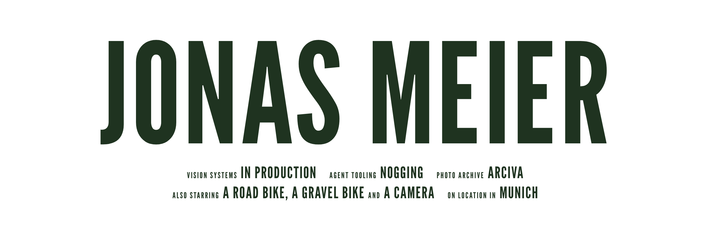

<picture>
  <source media="(prefers-color-scheme: dark)" srcset="assets/banner-dark.png">
  
</picture>

Hi, I'm Jonas. Photography came first: I wanted to know how a camera turns light into a picture, and that question eventually took me through physics and camera sensors to machine learning. These days I build computer-vision systems for factories in Munich. This GitHub is where the side projects live.

### What I'm tinkering with

**[Nogging](https://github.com/JoMe92/nogging)** is my playground for coding agents. Agents pick up issues in a sandbox on a Raspberry Pi, I steer from my phone, and I keep finding out how far I can let them run before I have to step in. Works with Claude Code, Codex and Pi.

**[Arciva](https://github.com/JoMe92/arciva)** exists because my own photo archive got out of hand. It's a self-hosted home for my RAW files, and **[Chroma Lab](https://github.com/JoMe92/arciva-chroma-lab)** is its little sibling: an image renderer in Rust that runs in the browser via WebAssembly.

### Off the clock

- **Photography.** Where all of this started.
- **Riding.** Road bike and gravel bike.
- **Film.** Logged on [Letterboxd](https://letterboxd.com/jonasmeier/). My bachelor's thesis was on colour calibration for multi-camera film rigs, so work and hobby have overlapped before.

### Find me

[LinkedIn](https://www.linkedin.com/in/jonas-meier-ai/) · [Letterboxd](https://letterboxd.com/jonasmeier/)
